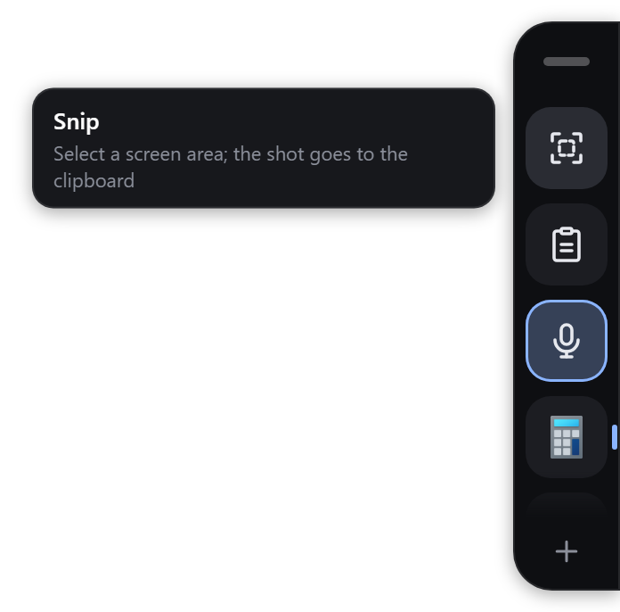
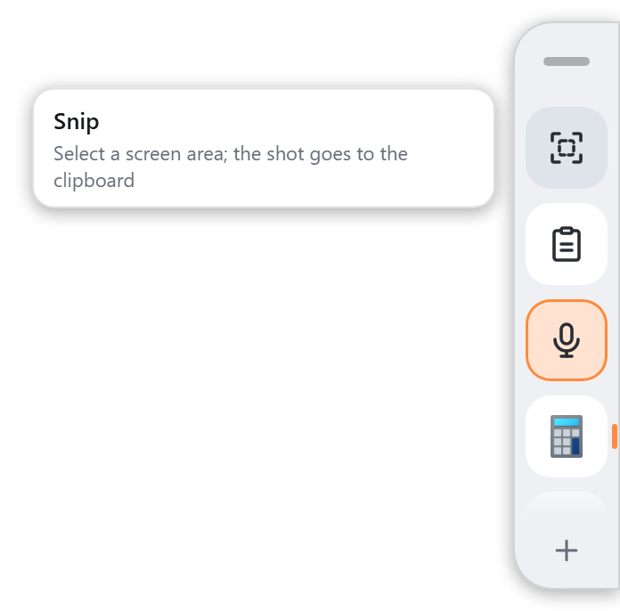
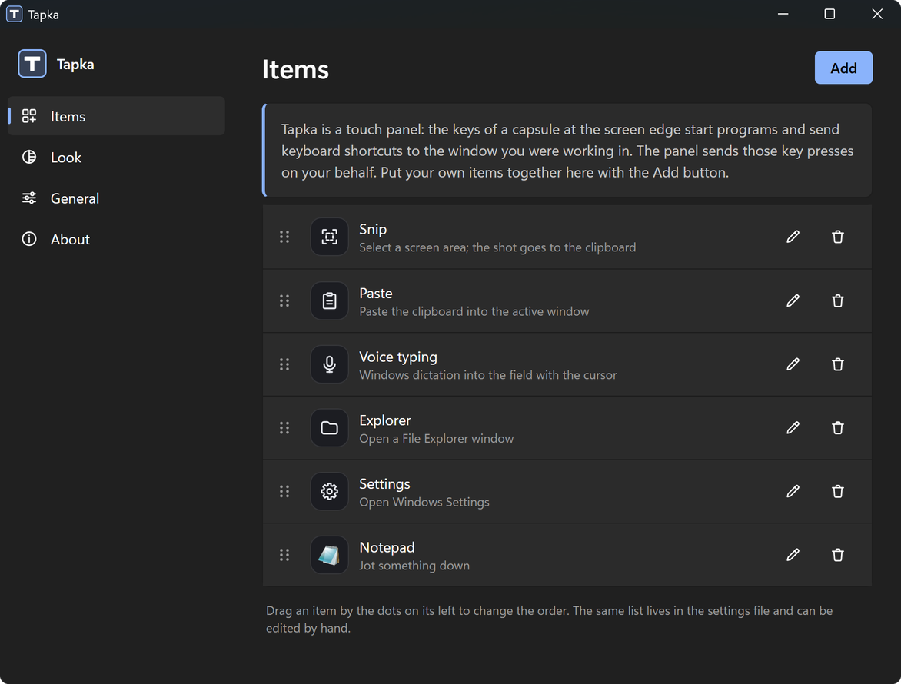

<p align="center"><a href="README.md">EN</a> · <b>RU</b></p>

<p align="center"></p>

<h1 align="center">Tapka</h1>

<p align="center">
  <a href="https://github.com/Sargares22/tapka/releases/latest"></a>
  
  <a href="LICENSE"></a>
</p>

<p align="center">
  <a href="#установка">Установка</a> · <a href="#что-она-умеет">Что она умеет</a> · <a href="#свои-клавиши">Свои клавиши</a> · <a href="#рецепты">Рецепты</a> · <a href="#приватность">Приватность</a> · <a href="CHANGELOG.md">Что нового</a>
</p>

Tapka — сенсорная панель для Windows 11: узкая капсула у края экрана с крупными клавишами. Клавиша отправляет сочетание клавиш в окно, где вы работали, либо запускает программу, открывает сайт, файл или папку. Сделана для планшетов и трансформеров: когда клавиатура отстёгнута, вместе с ней пропадают снимок экрана, вставка, диктовка и громкость, а панель задач, даже поставленная сбоку, сочетаний не шлёт. Капсула умеет прятаться, пока клавиатура подключена. Работает пальцем, пером и мышью.

<p align="center">
  
  
</p>

https://github.com/user-attachments/assets/1622f2fe-5a0e-46c8-a63a-c13895f1acb4

## Установка

1. Скачайте установщик со страницы [Releases](https://github.com/Sargares22/tapka/releases/latest): `Tapka_…_arm64-setup.exe` для ARM (Snapdragon), `Tapka_…_x64-setup.exe` для Intel и AMD.
2. Запустите его. Установщик не подписан, поэтому Windows покажет «Система Windows защитила ваш компьютер»: нажмите **Подробнее**, затем **Выполнить в любом случае**.
3. Права администратора не нужны. Tapka сразу встанет у правого края с четырьмя клавишами: «Отменить», «Снимок», экранная клавиатура и «Проводник». Если клавиатура подключена, вместо экранной будет «Повторить», а на экране с пером вместо «Проводника» — «Держать Shift». Рядом с капсулой откроется маленькое окно: до восьми ваших программ, сначала закреплённые на панели задач, потом те, чьи окна открыты; «Добавить» ставит отмеченные клавишами, и капсула показывает их с подсказкой «Коснитесь клавиши». «Не сейчас» или касание в другом месте закрывает окно насовсем.

### Установка через ИИ-агента

Вставьте эту фразу в Claude Code, Codex или другой агент на своём компьютере. Он проверит компьютер, поможет поставить Tapka, найдёт ваши программы, один раз спросит, какие добавить, и проверит, что они появились. Потом просите того же агента добавить ещё программы.

```text
Поставь мне Tapka и добавь мои программы, инструкция: https://raw.githubusercontent.com/Sargares22/tapka/main/docs/install.txt
```

Удалить: «Параметры» → «Установленные приложения». Антивирус насторожился, ведь панель шлёт нажатия клавиш? Загляните в [Приватность](#приватность).

## Что она умеет

- **Не забирает фокус.** Сочетание уходит в окно, где вы работали.
- **Только без клавиатуры.** Включите её в «Вид», и капсула прячется, пока клавиатура подключена. Значок в трее показывает и прячет её в любой момент.
- **Снимок без капсулы в кадре.** Клавиша «Снимок» прячет капсулу, пока вы выделяете область.
- **Четыре клавиши на виду.** Остальные листаются пальцем, а **+** внизу капсулы открывает редактор.
- **Где поставили, там и стоит.** Перетащите капсулу за ручку к левому, правому или верхнему краю, и она останется там даже после поворота экрана.
- **Как панель задач, только под палец.** Без клавиатуры клавиши раздвигаются. У запущенной программы видна метка, повторное касание выводит её окно вперёд или сворачивает; Tapka ничего не закрывает.
- **Клавиши под программу.** Выберите у клавиши в «Где показывать» одну программу, и клавиша появится, когда впереди окно этой программы. В первый раз капсула скажет: «Клавиши для …».
- **Shift держится для пера.** Касание «Держать Shift» (или Ctrl, Alt, Space) жмёт клавишу, пока вы рисуете, второе касание отпускает.
- **Отклик на касание.** Клавиша коротко вспыхивает и проседает, тихий щелчок включается в «Вид».
- **Добавить без печатания.** Закреплённые на панели задач программы, страницы Параметров Windows и готовые наборы добавляются касанием.
- **На ваш вкус.** Тёмная, светлая или как в Windows тема, любой акцент, три размера, русский и английский. Обновления тихие, раз за запуск, и отключаются.

Готовые действия Windows: снимок области, вставить, копировать, отменить, повторить, выделить всё, голосовой ввод, представление задач, показать рабочий стол, Проводник, Параметры, экранная клавиатура, история буфера, эмодзи, громче, тише, без звука, пауза, следующий трек, держать Shift, Ctrl, Alt или Space, Esc, четыре стрелки, пробел, во весь экран.

## Свои клавиши

Коснитесь **+** на капсуле или откройте настройки из значка в трее.

<p align="center"></p>

**Добавить** предлагает пять видов клавиш, а строка «Найти мои программы» под списком снова открывает карточку ваших программ из первого запуска:

- **Программа:** сверху закреплённые на панели задач, ниже все установленные, со своим названием и значком.
- **Действие Windows:** одно из готовых или страница Параметров, например Bluetooth, Wi-Fi, звук, экран или обновление.
- **Сайт или файл:** впишите адрес или выберите файл либо папку.
- **Сочетание клавиш:** нажмите его на клавиатуре или соберите кнопками Ctrl, Shift, Alt и Win.
- **Готовый набор:** несколько клавиш сразу: «Планшет», «Рисование», «Текст» или «Видео». Набор можно сразу отдать одной программе; клавиши, которые уже есть, второй раз не добавляются. «Сохранить мои клавиши…» записывает ваши клавиши, все или одной программы, в файл `.tapka`, которым можно поделиться; «Набор из файла…» показывает такой файл ещё одним набором и добавляет его клавиши к вашим.

Порядок меняется перетаскиванием за точки или прямо в капсуле: подержите клавишу, пока не появится её ярлык, и перенесите на новое место. Касание строки открывает карточку клавиши: название, подсказка, значок, где показывать и «Удалить», и удаление можно отменить.

### Файл настроек

Всё хранится в `%APPDATA%\sargares22.tapka\settings.json`, открыть его можно из окна настроек («Общие» → «Для опытных» → «Файл настроек»). Правьте руками, скриптом или через ИИ-агента: панель подхватит изменения за секунду.

```json
{
  "scale": 1.0,
  "top": 0.3,
  "edge": "right",
  "theme": "system",
  "accent": "#8ab4ff",
  "items": [
    { "name": "Снимок", "icon": "snip", "hint": "Выделить область экрана", "action": "hotkey", "keys": "win+shift+s" },
    { "name": "Почта", "icon": "chat", "action": "open", "target": "https://mail.example.com" }
  ]
}
```

- `action`: `open` с `target` (программа, файл, папка, адрес или `shell:AppsFolder\…`) либо `hotkey` с `keys`, например `ctrl+shift+k`, либо `hold` с `keys`: `shift`, `ctrl`, `alt` или `space`.
- `icon`: встроенный значок (все они есть в редакторе) или PNG либо SVG из папки `icons` рядом с файлом. Без него у программы будет её собственный значок, у остальных клавиш первая буква названия.
- `only_in`: имя exe программы или семейство её пакета Магазина, например `"only_in": "mspaint.exe"`. Клавиша есть в капсуле, только пока активно окно этой программы, и стоит сразу после первых двух общих клавиш. В редакторе это строка «Где показывать».
- `length` — наибольшая длина капсулы в клавишах, не меньше 2; её задаёт полоска на конце капсулы, если после касания «+» потянуть её. Капсула не бывает длиннее, чем нужно её клавишам и шкалам, поэтому пустых клеток в ней нет. Без поля капсула по числу клавиш, не больше четырёх, и со всеми шкалами.
- `top` от 0 до 1 задаёт место капсулы вдоль края, `tablet_only: true` прячет её при подключённой клавиатуре. Точный `top` и правило `lit` есть только в файле. `tour_done: true` Tapka пишет сама, когда окно с вашими программами при первом запуске закрыто.
- Клавиша с ошибкой пропускается, а что не так, скажет подсказка значка в трее.

### Шкалы

«Добавить индикатор» в разделе «Индикаторы» окна настроек ставит под клавишами маленькую шкалу: скруглённый квадратик, как клавиша, чья обводка заполняется от середины верха. Она показывает прогресс программы, выбранной из установленных (то, что программа показывает на своей кнопке в панели задач, полосу прогресса в своих окнах или проценты в начале заголовка), или числа из текстового файла, который может писать любой скрипт или программа, в UTF-8 или UTF-16.

Клавише программы шкала для своего прогресса не нужна: пока программа показывает прогресс на своей кнопке в панели задач, например при копировании в Проводнике, обводка клавиши заполняется, а когда прогресс кончился, пропадает.

В первой строке файла одно или два числа от 0 до 100 через пробел: первое заполняет шкалу, второе, если есть, — вторую тонкую обводку снаружи. Ещё до пяти строк, по 80 знаков, видны под названием и процентом шкалы, когда вы наводите на неё курсор или держите на ней палец. Выше 80 % шкала и обводка окрашиваются в цвет предупреждения.

```text
64 88
Диск D: 64 %
Скопировано 1240 из 1930 файлов
```

Несколько строк файла служебные: Tapka читает их сама и текстом не показывает. Время пишется по ISO 8601: `2026-10-26T11:00` — местное время этого компьютера, или с `Z` либо сдвигом вроде `+03:00`.

| Строка | Что делает |
|---|---|
| `обновлено: <время>` | Когда ваш скрипт последний раз получил числа. Без строки — время последней записи файла |
| `свежесть: <минуты>` | Насколько старыми могут быть числа, без строки 5 минут. Старше — шкала серая, сохраняет последний процент, а ярлык добавляет «обновлено 12 мин назад» |
| `сброс: <время>` | Когда число шкалы обнулится. Ярлык ведёт отсчёт, «сброс через 2 ч 33 мин», а если до сброса больше суток, называет день, «сброс пн, 11:00», дальше шести дней — и дату, «сброс пн 2 ноя, 11:00». Когда время прошло — «сбросился», процент остаётся до новой записи файла |
| `сброс2: <время>` | То же для второй обводки |

Английские ключи `updated:`, `fresh:`, `reset:` и `reset2:` тоже работают. Файла нет или в первой строке нет числа — шкала серая с «—», ярлык говорит «нет данных»; 0 % в этом случае не показывается.

```text
64 30
обновлено: 2026-10-21T14:05:00+03:00
свежесть: 15
сброс: 2026-10-21T19:00
сброс2: 2026-10-26T11:00
Неделя: 30 %
```

Шкалы видны все сразу, пока капсуле хватает места; клавиши занимают остальное и прокручиваются. Тонкая черта между клавишами и шкалами двигает границу: вниз — клавишам больше места, шкалы прокручиваются; вверх — шкалы растут, пока не станут видны все, а дальше капсула просто становится короче.

Откуда шкала берёт число:

| Путь | Что подходит | Что делать |
|---|---|---|
| Работает само | Копирование в Проводнике и другие программы, которые показывают прогресс на своей кнопке в панели задач | «Добавить индикатор» → «Программа» → выберите её |
| Работает, если программа показывает прогресс Windows | Рендер, загрузка, установщик: полоса в окне или проценты в начале заголовка | То же. Пустая серая шкала значит, что программа прогресс не показывает |
| Встроено | Лимиты Claude Code, Codex (ChatGPT) и Antigravity, в которые вы вошли на этом компьютере | «Добавить индикатор» → «Расход ИИ» → выберите сервис |
| Нужен ваш скрипт | Заряд, место на диске, любые свои числа | Скрипт пишет число в текстовый файл, шкала «Файл» читает его |

Шкала «Расход ИИ» заполняется долей истраченного 5-часового лимита, её тонкая обводка — недельного; ярлык считает время до обоих сбросов и говорит, почему числа старые, если прочитать не удалось. В файле настроек это `{ "name": "Claude", "limit": "claude" }`, `limit` вместо `program` или `file`:

- `limit`: `claude` (вход Claude Code), `chatgpt` (вход Codex), `antigravity-gemini` или `antigravity-claude` (модели Gemini в Antigravity или его модели Claude и GPT). Tapka спрашивает лимиты раз в 5 минут и только пока такая шкала есть. Без входа шкала серая и пишет «нет данных», никогда не 0 %. Чтобы подключить, коснитесь шкалы или нажмите «Подключить» в её карточке в разделе «Индикаторы» окна настроек: откроется окно входа самой программы, и через несколько секунд после входа шкала оживёт. Набирать ничего не нужно.

#### Свой источник за 10 минут

1. Напишите скрипт, который кладёт число в первую строку текстового файла. Строки подсказки идут ниже.
2. В Tapka: «Добавить индикатор» → «Файл», выберите этот файл.
3. Запускайте скрипт при входе в Windows: ярлык в папке «Автозагрузка» (`shell:startup`).

```powershell
$file = "$env:USERPROFILE\Documents\battery.txt"
while ($true) {
  $b = (Get-CimInstance Win32_Battery).EstimatedChargeRemaining
  Set-Content $file "$b`nЗаряд: $b %" -Encoding UTF8
  Start-Sleep -Seconds 60
}
```

Кроме лимитов ИИ, скрипты для чужих программ живут отдельно от Tapka: кода для них в панели нет. Такой скрипт для вас напишет ИИ-агент (см. [Установка через ИИ-агента](#установка-через-ии-агента)).

## Рецепты

Кроме шкал лимитов ИИ, Tapka не привязана к сторонним программам. Вот что к ней подключают:

- **Диктовка (Handy и подобные).** Добавьте «Сочетание клавиш», которое слушает программа, например `ctrl+space`. Чтобы клавиша светилась во время записи, допишите пункту правило `lit`: имя программы и заголовок её окна записи.

  ```json
  { "name": "Диктовка", "icon": "mic", "action": "hotkey", "keys": "ctrl+space",
    "lit": { "program": "handy.exe", "window": "Recording" } }
  ```

- **Перо и зажатый Shift.** «Добавить» → «Действие Windows» → «Держать Shift» (или Ctrl, Alt, Space). Касание нажимает клавишу и держит её, пока вы рисуете, клавиша светится, следующее касание отпускает. Если забыть, она отпустится сама через 20 секунд без касаний капсулы или когда впереди окажется другая программа. Остальные клавиши тем временем работают как обычно, вместе с зажатой. Только для одной программы:

  ```json
  { "name": "Shift", "icon": "shift", "action": "hold", "keys": "shift", "only_in": "mspaint.exe" }
  ```

- **Художникам.** «Добавить» → «Готовый набор», в «Где показывать» выберите «В одной программе» и свою рисовалку (Paint, Krita, Photoshop), затем «Добавить» у «Рисования». Отменить, Повторить, Держать Shift, Ctrl и Space и Снимок появятся в капсуле, только пока она впереди.
- **ИИ-чаты.** Приложение (ChatGPT, Claude, Copilot) добавляется как «Программа», чат в браузере как «Сайт или файл».
- **Рабочая папка.** «Добавить» → «Сайт или файл» → «Папка…».
- **Диплинки.** В поле адреса годится любая ссылка, которую открывает Windows: `ms-settings:bluetooth`, `ms-availablenetworks:` (Wi‑Fi), `ms-actioncenter:` (уведомления), `claude://code/new?folder=C:\Проекты\мой` и `codex://threads/new?path=C:\Проекты\мой` (новая сессия в папке проекта), `tg://resolve?domain=имя`. Набор схем зависит от программ, список есть в [awesome-deeplinks](https://github.com/f/awesome-deeplinks).
- **Сочетание другой программы.** Годится Ctrl, Shift, Alt, Win плюс буква, цифра, F1–F24, клавиша навигации, медиаклавиша, точка или запятая. Цифровой блок пока не поддерживается, а до программ, запущенных от имени администратора, нажатия не доходят.

## Приватность

Что панель делает:

- отправляет нажатия клавиш в активное окно, когда вы касаетесь клавиши с сочетанием или клавиши удержания;
- дважды в секунду читает список окон и их заголовки, чтобы отметить запущенные программы;
- если проверка обновлений включена, один раз за запуск обращается к GitHub;
- если есть шкала «Расход ИИ», раз в 5 минут читает вход Claude Code или Codex на этом компьютере и спрашивает его лимиты у Anthropic или OpenAI либо запускает без окна команду `agy` Antigravity; вход больше никуда не уходит и в журнал не пишется.

Чего она не делает: не записывает, что вы печатаете, никуда не отправляет заголовки окон и не собирает статистику. Журнал лежит только на вашем компьютере и ограничен по размеру.

## Собрать самому

Нужны Rust с инструментами MSVC и Node.js.

```
cargo test
node --test scripts/check-page.mjs
npx @tauri-apps/cli@2 build --target aarch64-pc-windows-msvc --no-bundle
```

Exe появится в `target/aarch64-pc-windows-msvc/release`, для Intel и AMD укажите `x86_64-pc-windows-msvc`. Своя сборка сама не обновляется: подписанные обновления делает `scripts/make-release.sh` с ключом проекта.

## Лицензия

[MIT](LICENSE), без гарантий; значки нарисованы для проекта, см. [glyphs/NOTICE.md](glyphs/NOTICE.md).
